 

---

## Sobre mim

Sou o Davi, fundador da **DaviTech TI**. Transformo a rotina de pequenos negócios em **sistemas, sites e automações** que realmente são usados: vendas, estoque, fidelização, painéis de dados e apps instaláveis (PWA).

- Cursando Análise e Desenvolvimento de Sistemas na UNIVAG
- Trabalho com clientes reais, de landing pages a sistemas de gestão
- Também atuo com análise de dados (Power BI, Python)
- Disponível para vagas de desenvolvedor full stack.
- Quer um site ou sistema para o seu negócio? Me chama no [Instagram](https://instagram.com/davitech_ti)

---

## Projetos no ar

| Projeto | O que é | Tecnologias | Link |
|---|---|---|---|
| **Esterco Turbinado** | Landing page de venda de adubo orgânico via WhatsApp | HTML, CSS, JavaScript | [abrir](https://estercoturbinado.davitech.com.br) |
| **Venda Adubo** | Sistema de vendas, estoque e metas com login | JavaScript, Cloudflare Workers | [abrir](https://vendaadubo.davitech.com.br) |
| **Guia do Lote** | Área pós-compra com guias em PDF por planta | HTML, CSS, JavaScript | [abrir](https://guiaadubo.davitech.com.br) |
| **Comunidade Gatti** | Fidelização com pontos, ranking e grupo | JavaScript, Cloudflare Workers | [abrir](https://fidelizadosgatti.davitech.com.br) |
| **KinoraFit** | PWA para acompanhar treinos e evolução de carga | JavaScript, PWA, Netlify | [abrir](https://kinorafit.davitech.com.br) |

---

## Stack

  

---

## Contribuições

<picture>
  <source media="(prefers-color-scheme: dark)" srcset="https://raw.githubusercontent.com/cacique01/cacique01/output/github-snake-dark.svg" />
  <source media="(prefers-color-scheme: light)" srcset="https://raw.githubusercontent.com/cacique01/cacique01/output/github-snake.svg" />
  
</picture>

---

**Vamos tirar sua ideia do papel?** → [@davitech_ti](https://instagram.com/davitech_ti)

